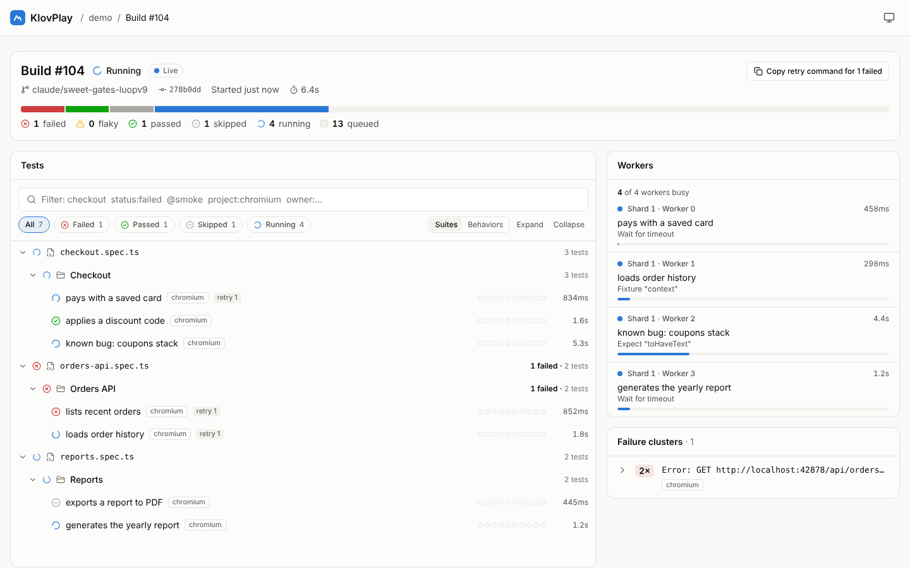
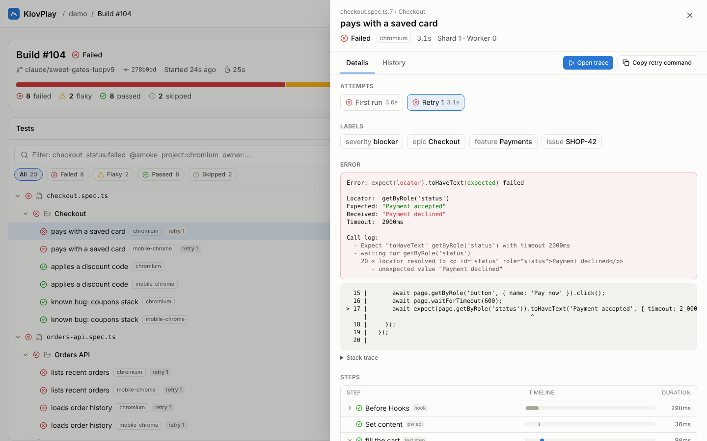
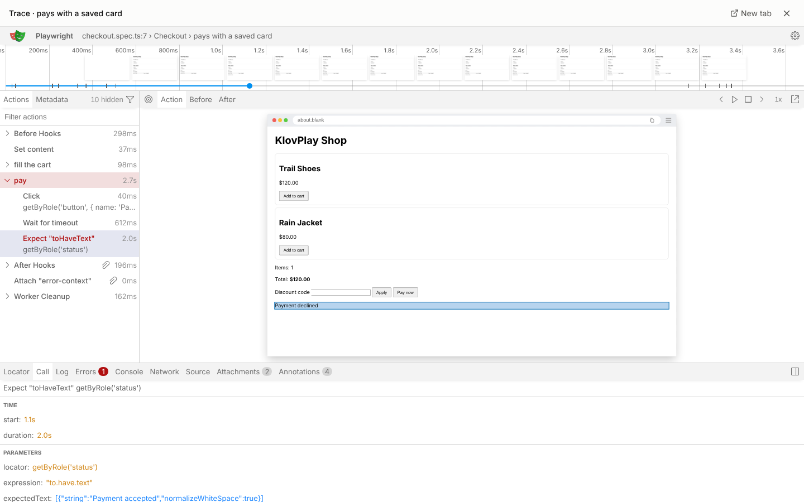
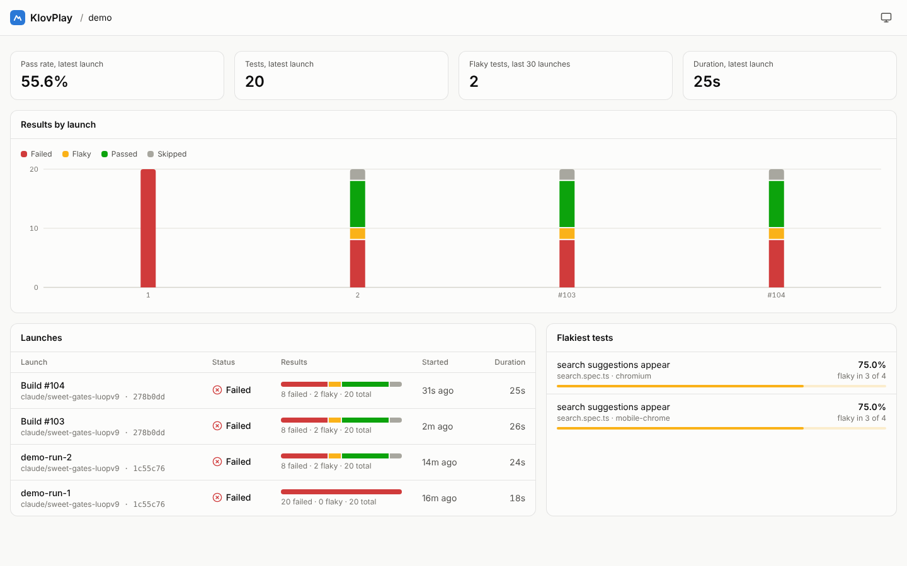

# KlovPlay

Real-time reporting for Playwright, in the spirit of [Klov](legacy/), with Allure-style analytics.

Results stream to the dashboard while tests are still running: you watch the progress bar fill, see what every worker is doing, and open a failure (with its trace) seconds after it happens. You don't have to wait for the whole suite to finish.



## Features

- **Live launches.** A progress bar, per-worker swimlanes (current test, current step, slow-step warning) and a test tree that update over Server-Sent Events as tests run.
- **Sharding built in.** Every Playwright shard that reports the same `CI_RUN_ID` merges into one launch, with no post-run merge step.
- **Failure clusters.** Failures are grouped by normalized error (UUIDs, timestamps, ports and machine paths removed), so 40 tests broken by one 502 show up as one card.
- **Test details.** Attempts, Allure labels (epic, feature, story, severity, owner, issue), the error with Playwright's code snippet, a step waterfall, screenshots, video and console output.
- **Embedded trace viewer.** Traces open in Playwright's own trace viewer inside the dashboard, loaded straight from object storage. Nothing to download.
- **History and flakiness.** A 10-run status strip and a duration-vs-average badge on every test, per-test history with pass and flaky rates, and a project trend with the flakiest tests.
- **Copy retry command.** `npx playwright test file:line --project=…` for one test, one cluster, or every failure in a launch.
- **Scalable ingestion.** Batched writes, acknowledgements only after commit, back-pressure, and idempotent events. Artifacts go straight to S3 through pre-signed URLs and never pass through the server.

| Test details | Trace viewer | Project trends |
| --- | --- | --- |
|  |  |  |

## How it works

```
Playwright (any number of shards)
  └─ @klovplay/playwright-reporter ──HTTP batches──▶ klovplay-server (Rust, axum)
        │                                              ├─ bounded channel → batch flusher → PostgreSQL
        └──pre-signed PUT──▶ S3 / RustFS               └─ per-launch broadcast ──SSE──▶ React dashboard
                                   ▲                                                       │
                                   └────────────── pre-signed GET (screenshots, video, traces) ──┘
```

The reporter, server and dashboard share one contract. `crates/schema` defines it in Rust and exports it to TypeScript with ts-rs. See [docs/DESIGN.md](docs/DESIGN.md) for the delivery guarantees and the data model.

## Quick start

Requirements: Docker with Compose.

```bash
cp .env.example .env             # set ADMIN_TOKEN to a long random value
docker compose up -d --build     # PostgreSQL, RustFS (S3-compatible) and KlovPlay on :8080
```

Create a project and keep its API key (it is shown once):

```bash
curl -X POST http://localhost:8080/api/v1/projects \
  -H "Authorization: Bearer $ADMIN_TOKEN" -H "Content-Type: application/json" \
  -d '{"slug": "web", "name": "Web app"}'
# or: docker compose exec server klovplay-server create-project --slug web --name "Web app"
```

Add the reporter to `playwright.config.ts` (keep your usual reporter for the terminal):

```ts
export default defineConfig({
  reporter: [
    ['list'],
    ['@klovplay/playwright-reporter', { serverUrl: 'http://localhost:8080', project: 'web' }],
  ],
  use: { trace: 'retain-on-failure', screenshot: 'only-on-failure', video: 'retain-on-failure' },
});
```

Run your tests and open the link the reporter prints:

```bash
KLOVPLAY_API_KEY=kp_... npx playwright test
# [klovplay] streaming results live to http://localhost:8080/projects/web/launches/…
```

To try it without your own suite, `examples/playwright-demo` has 10 tests covering passing, failing, flaky, skipped, timed-out and expected-failure cases:

```bash
pnpm install && pnpm --filter @klovplay/playwright-reporter build
pnpm --filter klovplay-example exec playwright install chromium
KLOVPLAY_API_KEY=kp_... KLOVPLAY_PROJECT=web pnpm demo
```

## Reporter

| Option | Env var | Default | |
| --- | --- | --- | --- |
| `serverUrl` | `KLOVPLAY_SERVER_URL` | `http://localhost:8080` | |
| `apiKey` | `KLOVPLAY_API_KEY` | – | Required. Project API key. |
| `project` | `KLOVPLAY_PROJECT` | – | Required. Project slug. |
| `ciRunId` | `KLOVPLAY_CI_RUN_ID`, `CI_RUN_ID` | detected | Shards with the same id merge into one launch. Detected on GitHub Actions, GitLab, CircleCI, Buildkite, Azure Pipelines and Jenkins. |
| `buildNumber`, `branch`, `commitSha` | `KLOVPLAY_BUILD_NUMBER`, `KLOVPLAY_BRANCH`, `KLOVPLAY_COMMIT_SHA` | detected | Falls back to the local git checkout. |
| `stepMode` | | `steps-only` | `steps-only` streams `test.step()` calls; `all-api` adds hooks, fixtures, page actions and expects. |
| `uploadAttachments` | | `all` | `all`, `failures` or `none`. |
| `maxAttachmentBytes` | | 500 MB | |
| `finalTimeoutMs` | | 120 000 | How long the end of the run waits for uploads and pending events. |
| `enabled` | `KLOVPLAY_DISABLED=1` | `true` | |

Reporting never fails or slows your tests. If the server is unreachable, events stay queued and retry, and the run finishes normally.

**Labels.** Use annotations or `@key:value` tags. The helpers return plain Playwright annotations:

```ts
import { epic, feature, issue, owner, severity } from '@klovplay/playwright-reporter/annotations';

test('pays with a saved card', { tag: '@smoke', annotation: [severity('critical'), epic('Checkout'), owner('payments')] }, async () => {
  test.info().annotations.push(issue('SHOP-42')); // labels added at runtime work too
});
test('lists orders', { tag: ['@feature:Orders', '@story:History'] }, async () => {});
```

**Sharding.** In CI, the run id is derived from the provider, so `npx playwright test --shard=2/4` jobs in one workflow run join the same launch. Elsewhere, set `CI_RUN_ID` to the same value in every shard.

## Server configuration

| Env var | Default | |
| --- | --- | --- |
| `DATABASE_URL` | – | PostgreSQL 13+. Migrations run on startup. |
| `BIND_ADDR` | `0.0.0.0:8080` | |
| `PUBLIC_URL` | `http://localhost:8080` | Used in links returned to reporters. |
| `ADMIN_TOKEN` | – | Enables `POST /api/v1/projects`. |
| `S3_BUCKET`, `S3_REGION` | `klovplay-artifacts`, `us-east-1` | |
| `S3_ENDPOINT` | AWS | Endpoint the server uses, e.g. `http://s3:9000` inside Compose. |
| `S3_PUBLIC_ENDPOINT` | `S3_ENDPOINT` | Endpoint embedded in pre-signed URLs. Must be reachable by reporters and browsers. |
| `S3_FORCE_PATH_STYLE` | `false` | `true` for RustFS, MinIO, Garage. |
| `S3_ACCESS_KEY_ID`, `S3_SECRET_ACCESS_KEY` | AWS credential chain | |
| `S3_ENSURE_BUCKET` | `false` | Create the bucket and its CORS rule (needed by the trace viewer) at startup. |
| `S3_CORS_ORIGINS` | `*` | Origins allowed to fetch artifacts. |
| `PRESIGN_TTL_SECS` | `3600` | |
| `INGEST_CHANNEL_CAPACITY` | `50000` | Events buffered before the server answers 503. |
| `FLUSH_MAX_EVENTS`, `FLUSH_INTERVAL_MS` | `250`, `200` | Batch size and latency of database writes. |
| `STALE_LAUNCH_MINUTES` | `30` | Launches with no activity for this long are marked interrupted. |
| `WEB_DIR` | `apps/web/dist` | Built dashboard. |

## API

Ingestion endpoints take `Authorization: Bearer <project API key>`. Read endpoints are open; put the server behind your SSO proxy for now.

| Method | Path | |
| --- | --- | --- |
| `POST` | `/api/v1/launches/init` | Join or create the launch for a CI run (shard-aware). |
| `POST` | `/api/v1/events/batch` | Ordered telemetry events. Answers after the events are stored. |
| `POST` | `/api/v1/launches/{id}/heartbeat` | Keeps a launch with long, quiet tests alive. |
| `POST` | `/api/v1/artifacts/presign`, `/api/v1/artifacts/complete` | Pre-signed uploads. |
| `GET` | `/api/v1/launches/{id}/stream` | Live diffs (SSE). |
| `GET` | `/api/v1/projects`, `/api/v1/projects/{slug}/launches`, `/api/v1/projects/{slug}/analytics` | |
| `GET` | `/api/v1/launches/{id}`, `/api/v1/launches/{id}/tests` | Summary, workers, clusters; tests with history. |
| `GET` | `/api/v1/executions/{id}`, `/api/v1/projects/{slug}/history/{fingerprint}` | |
| `POST` | `/api/v1/projects` | Admin: create a project and API key. |

## Development

```
crates/schema        wire contract (Rust → TypeScript via ts-rs)
crates/server        axum server, flusher, SSE, S3
migrations           PostgreSQL schema (sqlx)
packages/playwright-reporter
apps/web             React dashboard
examples/playwright-demo
```

```bash
docker compose up -d postgres s3
cp .env.example .env && set -a && . ./.env && set +a
cargo run -p klovplay-server               # API on :8080
pnpm install && pnpm dev:web               # dashboard on :5173, proxied to :8080

cargo test -p klovplay-schema              # regenerates the TypeScript bindings
cargo test --workspace                     # integration tests need DATABASE_URL (and S3 for artifacts)
cargo sqlx prepare --workspace             # after changing SQL: refresh .sqlx for offline builds
pnpm -r run typecheck && pnpm -r run test
```

## Legacy Klov

The previous Klov server for ExtentReports, distributed as the `anshooarora/klov` Docker image, is still available. Its Compose file is in [legacy/docker-compose.yml](legacy/docker-compose.yml).
